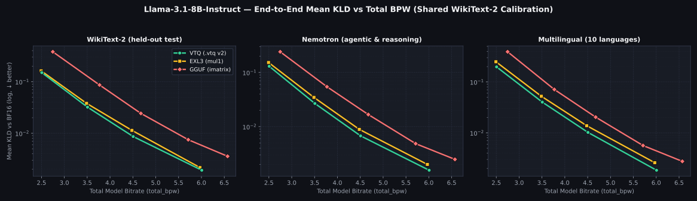
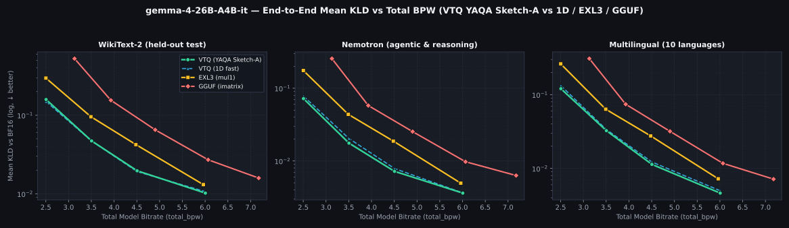
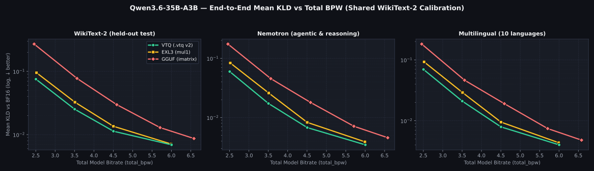

# VTQ — Velri Trellis Quant

**[Website](https://velri-inference.github.io/)** · **[Format Spec (EN)](docs/EN/vtq-format.md) / [RU](docs/RU/vtq-format.md)** · **[Benchmarks (EN)](docs/EN/paper-benchmarks.md) / [RU](docs/RU/paper-benchmarks.md)** · **[Velri Engine](https://github.com/velri-inference/velri)** · **[Velri-lib](https://github.com/velri-inference/velri-lib)** · **[llms.txt](llms.txt)** · **License: [GPL-3.0](LICENSE)**

**VTQ** (*Velri Trellis Quant*, `.vtq`) is a hardware-co-designed trellis weight quantization format for Large Language Models (LLMs), built for the [Velri](https://github.com/velri-inference/velri) inference engine around self-contained **`16×256` (`4,096`-weight) supertiles** (`1.5–6.0 bpw`), targeting both **AVX2 CPUs** (`vpshufb`, compiled without AVX-512) and **GPUs** (`FP32` and `DP4A INT8` GEMV/GEMM) with a lower operation count per 256 weights than EXL3, 1.3–5.1× faster model quantization than EXL3 conversion, and strictly lower teacher-forced KL divergence than both EXL3 (`mul1`) and GGUF (`imatrix`) across dense, non-power-of-two MoE, and hybrid linear-attention MoE architectures.

- **Specification & Kernels**: [EN (`docs/EN/vtq-format.md`)](docs/EN/vtq-format.md) | [RU (`docs/RU/vtq-format.md`)](docs/RU/vtq-format.md) — quantizer [`src/vtq.py`](src/vtq.py), `.vtq` v2 container [`src/vtq_format.py`](src/vtq_format.py), AVX2 kernel [`src/cpu/vtq_avx2_bench.c`](src/cpu/vtq_avx2_bench.c), CUDA `sm_120` kernel [`src/cuda/vtq_matvec_bench.cu`](src/cuda/vtq_matvec_bench.cu), optional C++ tile packer/unpacker [EN](docs/EN/vtq-native-io.md) / [RU](docs/RU/vtq-native-io.md).
- **End-to-End Benchmarks & Reproduction**: [EN (`docs/EN/paper-benchmarks.md`)](docs/EN/paper-benchmarks.md) | [RU (`docs/RU/paper-benchmarks.md`)](docs/RU/paper-benchmarks.md) — runner [`src/run_paper_benchmarks.py`](src/run_paper_benchmarks.py), figure generator [`src/plot_paper_benchmarks.py`](src/plot_paper_benchmarks.py), raw JSONs in [`results/`](results/).

## Current VTQ Architecture (`.vtq` v2)

1. **Single-Stream `16×256` Supertile (`vtq_st16_*`, `816..3,184 B`)**: coded trellis bits `c[16][16][2]`, sign planes, uncoded lattice/bit planes (`Gosset[8,4,4]`, `D4[4,3,2]`, `D4_eq`, `1b/2b/4b`), `16`-weight subgroup gain indices, and linear `uint8 u_sb[16]` superblock scales (`× 1/128`, no runtime `exp2f`) live in one 64-byte-aligned contiguous struct shared identically across disk, CPU, and GPU (reaching up to `1,476.9 GB/s` = `96.4%` of peak HBM bandwidth on `RTX PRO 6000 Blackwell`).
2. **Zero-Shuffle `256`-Step Tail-Biting Trellis (`ν = 10`, `1,024` states, `nl = 16` subsets)**: each `16`-column subgroup traverses all `16` rows of a supertile sequentially and wraps around (`Block16-LDLQ` causal Cholesky compensation + CUDA radix-4 Viterbi). On GPU, state advance + subset lookup reduces to `s = ((s << 1) | bit) & 0x3FF` + one shared-memory `Joint-1024` LUT load (`0` runtime Galois popcounts, `0` cross-row warp shuffles). On AVX2 CPU, state advance is a single `_mm256_srli_epi16` with `vpshufb`-only codebooks (`s8_32`, `u8`, additive `at2_16_16` and bit-7-zeroed `at2z_32_32` without `vpblendvb`).
3. **Outer-DCT / Kronecker-Hadamard Input Rotation & Global Fisher Slice DP**: orthogonal rotation $\mathcal{R}_K = (H_{b_1} \otimes H_{b_2}) \otimes_{\text{outer}} \operatorname{DCT\text{-}II}_q$ handles non-power-of-two widths (`16`-row granularity on $M$ instead of `128`, avoiding EXL3's `+9%` padding overhead on `704`-dim MoE layers), while inverse-CDF Row-Fisher sensitivities drive a global DP knapsack across `20` active `nl = 16` formats (`1.5..6.0 bpw`) plus `VTQ` row-ring quantization for `embed_tokens` and `lm_head`.
4. **`.vtq` v2 Container (`MAGIC = b"VTQ\0"`, `VERSION = 2`)**: 64-byte header + 64-byte-aligned tensor/supertile payload + unlimited UTF-8 JSON footer (`VtqFile` remains backward-compatible with v1). Optional native C++17 tile I/O ([`src/vtq_native.py`](src/vtq_native.py)) speeds up FP32 weight materialization by `6.2–8.3×` over NumPy.

## End-to-End KLD Benchmarks (`VTQ` vs `EXL3` vs `GGUF`)

All three formats (`VTQ` `.vtq` v2, `EXL3` `mul1`, and `GGUF` `imatrix`) are quantized from the same BF16 checkpoint on the **exact same domain-neutral calibration corpus** (`wikitext-2-raw-v1` `train`, `64 × 2048 = 131,072` tokens) and evaluated end-to-end (including quantized `embed_tokens` and `lm_head`, measured by full serialized text-model `total_bpw = total_text_bytes * 8 / total_text_params`) on three strictly disjoint held-out traces (`WikiText-2` `test`, `Nemotron` agentic/reasoning dialogues, and `10`-language `Multilingual`, paired bootstrap `B = 2000`).

Across all **3 models × 4 target bitrates (`2.5, 3.5, 4.5, 6.0` bpw) × 3 traces (`36 / 36` cells)**, `VTQ` achieves strictly lower teacher-forced KLD than both `EXL3` and `GGUF` (`−15%..−22%` vs `EXL3` on dense `Llama-3.1-8B`, **`−47%..−58%` — over `2×` lower KLD — on `gemma-4-26B-A4B-it`** at `2.5–4.5 bpw`, and `−16%..−33%` on `Qwen3.6-35B-A3B`), while quantizing **1.3–5.1× faster** than `EXL3` ([quantization time chart](docs/figures/paper_quant_time.svg), [full tables EN](docs/EN/paper-benchmarks.md) / [RU](docs/RU/paper-benchmarks.md)).

### Headline Summary Table (Domain-Neutral Calibration, `nem` / `mul` / `wt2` KLD)

| Model | Target | `VTQ` (`total_bpw`, KLD `nem`/`mul`/`wt2`) | `EXL3` (`total_bpw`, KLD `nem`/`mul`/`wt2`) | `GGUF` (`total_bpw`, KLD `nem`/`mul`/`wt2`) | Quant Speedup (`VTQ` vs `EXL3`) |
| :--- | :---: | :---: | :---: | :---: | :---: |
| **`Llama-3.1-8B-Instruct`** *(Dense 8B)* | `2.5 bpw` | `2.51` — **`0.130 / 0.198 / 0.150`** | `2.49` — `0.153 / 0.249 / 0.162` | `2.75` (`IQ2_S`) — `0.241 / 0.391 / 0.379` | **`3.3×`** (`158.5 s` vs `527.5 s`) |
| **`Llama-3.1-8B-Instruct`** | `3.5 bpw` | `3.51` — **`0.027 / 0.040 / 0.032`** | `3.49` — `0.035 / 0.052 / 0.038` | `3.77` (`IQ3_M`) — `0.054 / 0.071 / 0.086` | **`2.6×`** (`199.3 s` vs `526.5 s`) |
| **`gemma-4-26B-A4B-it`** *(128-Exp MoE, `I=704`)* | `2.5 bpw` | `2.51` — **`0.078 / 0.132 / 0.149`** | `2.50` — `0.175 / 0.261 / 0.297` | `3.13` (`IQ2_S`) — `0.255 / 0.308 / 0.526` | **`4.2×`** (`431.8 s` vs `1811.4 s`) |
| **`gemma-4-26B-A4B-it`** | `3.5 bpw` | `3.51` — **`0.020 / 0.034 / 0.047`** | `3.49` — `0.044 / 0.063 / 0.096` | `3.93` (`IQ3_M`) — `0.058 / 0.074 / 0.155` | **`3.0×`** (`483.1 s` vs `1437.4 s`) |
| **`Qwen3.6-35B-A3B`** *(256-Exp Hybrid MoE)* | `2.5 bpw` | `2.50` — **`0.060 / 0.070 / 0.075`** | `2.52` — `0.083 / 0.093 / 0.095` | `2.46` (`IQ2_S`) — `0.174 / 0.182 / 0.270` | **`5.1×`** (`791.2 s` vs `4014.0 s`) |
| **`Qwen3.6-35B-A3B`** | `3.5 bpw` | `3.50` — **`0.017 / 0.021 / 0.025`** | `3.51` — `0.026 / 0.029 / 0.033` | `3.56` (`IQ3_M`) — `0.045 / 0.046 / 0.077` | **`4.3×`** (`904.0 s` vs `3905.6 s`) |

*Full 4-bitrate tables (`2.5 / 3.5 / 4.5 / 6.0 bpw`), $\Delta\text{PPL}$, and 4-bitrate suite timings (`2.1×–2.8×` faster end-to-end vs `EXL3` on `RTX PRO 6000 Blackwell`) are in [docs/EN/paper-benchmarks.md](docs/EN/paper-benchmarks.md) ([RU](docs/RU/paper-benchmarks.md)).*







## Research Evolution: From `llama.cpp` `IQ*_K` through `LTQ` to `VTQ`

Constraints held constant from the start: fast decoding on both GPU and AVX2 CPU (lookup tables fitting `pshufb`), a lower operation count per 256 weights than EXL3, quantization substantially faster than EXL3 conversion, and quality matching or beating EXL3 at equal total model bitrate. Steps 1–12 trace the earlier prototypes leading up to current VTQ (step 13).

1. **GGUF `IQ2_K..IQ6_K` block quants without changing the binary layout** (`.liqk v1`, built on top of the `IQ2_K..IQ6_K` / `JQ2_K..JQ6_K` formats from [`llama.cpp` PR #30715](https://github.com/ggml-org/llama.cpp/pull/30715) / [#30718](https://github.com/ggml-org/llama.cpp/pull/30718), `GGML_TYPE_IQ2_K = 45 .. IQ6_K = 49`). Adding block-sequential Cholesky error compensation (`LDLQ`) and analytical post-LDLQ superblock scale refitting cut teacher-forced KLD by `−34..−49%` while staying 100% byte-compatible with `.gguf` from PR #30715/#30718. The remaining ceiling was the GGUF block header granularity itself.
2. **Custom `.liqk v2` container.** Vector grid banks in the sub-block header, half-bit formats, Hadamard-256 rotation, row-slice bit allocation via a Fisher-weighted DP knapsack, and scale polishing brought another `−21..−44%` KLD reduction — yet EXL3 remained ahead by `+0.23..0.35` equivalent bits on dense 8B models and `+0.45` bits on MoE.
3. **MoE insight: global bit allocation dominates per-expert Hessians.** Ablating routed expert Hessians barely moved KLD, whereas shifting `+0.03 bpw` onto attention (`~3%` of MoE parameters) cut end-to-end KLD by `36–43%`, motivating full-model slice DP over uniform per-layer rates.
4. **Core quantizer search -> Ungerboeck TCQ.** $E_8$ lattice coding only helped by `+0.06..0.10` bits near `2 bpw`, while wide bitshift-trellis tables broke AVX2 `pshufb` budgets. **Ungerboeck TCQ** (`1` coded bit/weight, `10`-bit trellis memory, parity-masked subset labels, joint Viterbi subgroup gain search) gained `+0.23 / +0.12 / +0.09` bits over `.liqk v2` on i.i.d. Gaussian sources at $K = 2 / 3 / 4$ and `+0.15..0.25` equivalent bits on real LLMs.
5. **CUDA Viterbi (`src/cuda/tcq_viterbi.cu`).** Cut 1B quantization from `580 s` to `41 s`; radix-4 transitions, in-register/shared traceback, and pre-filtered gain candidates made quantization `3–5.6×` faster than EXL3 on 3B.
6. **Closing the equal-bitrate gap with EXL3.**
   - Two-level scaling (per-row `fp16` + per-`256` superblock scale) for outlier-heavy `down_proj` / `o_proj` matrices.
   - Rate-matched `2–4` bit subgroup gain headers, **tail-biting trellis** (`−0.017..−0.020` bits free of side information), **extended `8 / 16` Ungerboeck subsets** (shrinking the $K = 2$ gap to $R(D)$ from `0.176` to `0.118` bits), and higher relative Hessian damping (`0.20–0.30`).
   - Rejected after testing: 64-entry tables (`−20%` CPU speed for noise-level KLD change), 32-weight shared headers across two output rows, headerless formats, output-side rotation, and alternating-row half-integer mixes.
7. **Eliminating the integer-rate mixing penalty.** Mixing `2 bpw` and `3 bpw` slices lost up to `1.25×` KLD against native `2.5 bpw`. Introducing fractional uncoded sub-lattices inside Viterbi (`D2` pairs, `D4` quads, `Gosset` octads) reached `0.25 bpw` rate steps and matched/beat EXL3 on 1B and 3B.
8. **Deterministic Fisher sampling.** Inverse-CDF token sampling with fixed seeds reduced cross-run DP allocation variance from `±5%` KLD to `~1%`; removing Fisher weights degrades KLD by `~2×`.
9. **`LTQ` prototype (`19` formats, `2.04–5.29 bpw`) and row rings.** Frozen in `src/ltq_format.py` (`0` mismatches across 19 tile + 17 ring formats) and validated on embeddings/PLE tables (`Gemma 4 E4B` PLE at `4.25 bpw`: `1.39 GiB` vs `2.65 GiB` `int8`). Early self-calibrated checks on `Qwen3-8B`, `Qwen3-30B-A3B`, and `Qwen3.8-27B` showed strong gains, motivating a strict domain-neutral calibration audit (`WikiText-2` `train`).
10. **From `LTQ` / `SoA` to current `VTQ` (`.vtq` v2).** Replaced `6`-pointer `SoA` slices and `exp2f` exponents with the single-stream `16×256` `vtq_st16_*` supertile and linear `uint8 u_sb[16]`, eliminated GPU Galois ALU and cross-row shuffles via the `256`-step intra-subblock trellis + `Joint-1024` shared-memory LUT, introduced `at2_16_16` / `at2z_32_32` `vpblendvb`-free AVX2 codebooks to bring full `nl = 16` subsets to `K = 1.5..6.0`, added Outer-DCT rotation for non-power-of-two shapes, and verified `36 / 36` neutral-calibration KLD wins over upstream `EXL3` and `GGUF` across `8B–35B` models.

## Repository Layout

| Path | Contents |
| :--- | :--- |
| [`src/vtq.py`](src/vtq.py), [`src/vtq_format.py`](src/vtq_format.py), [`docs/EN/vtq-format.md`](docs/EN/vtq-format.md) ([RU](docs/RU/vtq-format.md)) | **Current VTQ** quantizer (`16×256` supertiles, `20` `nl = 16` formats + `_FAST` modes), `.vtq` v2 reader/writer (`VtqWriter` / `VtqFile`), and format specification |
| [`src/run_paper_benchmarks.py`](src/run_paper_benchmarks.py), [`src/plot_paper_benchmarks.py`](src/plot_paper_benchmarks.py), [`docs/EN/paper-benchmarks.md`](docs/EN/paper-benchmarks.md) ([RU](docs/RU/paper-benchmarks.md)) | End-to-end neutral-calibration benchmark suite (`VTQ` vs `EXL3` vs `GGUF` on `Llama-3.1-8B`, `gemma-4-26B`, `Qwen3.6-35B`) and SVG/PNG figure generator |
| [`src/cpu/vtq_avx2_bench.c`](src/cpu/vtq_avx2_bench.c), [`src/cuda/vtq_matvec_bench.cu`](src/cuda/vtq_matvec_bench.cu) | **VTQ** single-thread AVX2 (`-mno-avx512f`) and CUDA `sm_120` FP32 / DP4A GEMV & GEMM decode kernels |
| [`src/vtq_native.py`](src/vtq_native.py), `src/native/vtq_*tiles.cpp`, [`docs/EN/vtq-native-io.md`](docs/EN/vtq-native-io.md) ([RU](docs/RU/vtq-native-io.md)) | Optional C++17 tile packer/unpacker accelerating Python FP32 weight materialization by `6.2–8.3×` |
| [`src/tcq_proto.py`](src/tcq_proto.py), `src/cuda/tcq_viterbi.cu` | CUDA radix-4 Viterbi & causal `Block16-LDLQ` trellis encoders, codebook training, Gaussian R(D) rig |
| [`src/eval_kld.py`](src/eval_kld.py), [`src/prepare_traces.py`](src/prepare_traces.py) | Teacher-forced KLD / Perplexity evaluator (`B = 2000` paired bootstrap) and evaluation trace builder |
| [`src/hybrid_quant.py`](src/hybrid_quant.py), [`src/streaming_quant.py`](src/streaming_quant.py), [`src/gguf_utils.py`](src/gguf_utils.py) | Layer-streaming model loaders/evaluators and GGUF / `libggml` utilities (including legacy PR `#30715` `IQ2_K..IQ6_K` support) |
| `src/iqk_format.py`, `src/liqk_v2.py`, `src/ltq_format.py`, `src/q4v.py` | Earlier research prototypes (`.liqk v1` on `IQ*_K`, `.liqk v2`, `LTQ`, and experimental non-trellis `Q4V1`) |
| [`results/`](results/), [`docs/figures/`](docs/figures/) | Raw benchmark JSON artifacts (`paper_*.json`, kernel speed, selftests) and publication SVG/PNG charts |

## Quick Start & Reproducing

`main` keeps `data/` untracked; the complete turnkey reproduction setup with tracked held-out evaluation traces (`data/wikitext2_test.raw` and `data/{,gemma4/,qwen35/}{nemotron,multilingual}_trace.json`), `SHA-256` checksums, and step-by-step instructions lives on the [`paper-repro`](https://github.com/velri-inference/vtq-research/tree/paper-repro) branch (`git checkout paper-repro`).

```bash
python -m src.vtq_format              # .vtq v2 container & 16x256 supertile round-trip self-test
python -m src.plot_paper_benchmarks   # regenerate all SVG/PNG figures in docs/figures/ from results/paper_*.json
```

## Velri Ecosystem

| Repository | Role |
| :--- | :--- |
| **[velri-inference/velri](https://github.com/velri-inference/velri)** | Native C23/C++23 + Khronos Slang AOT LLM inference engine (CPU & Vulkan 1.3) |
| **[velri-inference/velri-lib](https://github.com/velri-inference/velri-lib)** | Standalone C23 tensor, execution graph, and Slang AOT kernel library (`VelriLib::velri`) |
| **[velri-inference/vtq-research](https://github.com/velri-inference/vtq-research)** *(this repo)* | **VTQ** (*Velri Trellis Quant*, `.vtq` v2) format specification, quantizer, kernels, and benchmarks |
| **[velri-inference.github.io](https://velri-inference.github.io/)** | Unified ecosystem website and full LLM reference ([`llms-full.txt`](https://velri-inference.github.io/llms-full.txt)) |

## FAQ

- **How does VTQ differ from EXL3 and GGUF?** Unlike GGUF block quantizers, VTQ uses a 256-step tail-biting Ungerboeck trellis (`1,024` states, `nl = 16` subsets) with global Row-Fisher DP bit allocation across `1.5–6.0 bpw`. Compared to EXL3, VTQ uses a single-stream `16×256` supertile with `16`-row Outer-DCT/Kronecker-Hadamard granularity (avoiding `+9%` padding overhead on non-power-of-two MoE dimensions such as `704`), runs zero-shuffle lookup decoding on both GPU and AVX2 CPU, quantizes `1.3–5.1×` faster, and achieves strictly lower KLD across `36/36` neutral-calibration cells.
- **Does VTQ require AVX-512 on CPU?** No. VTQ CPU codebooks (`s8_32`, `u8`, `at2_16_16`, `at2z_32_32`) are co-designed specifically for **AVX2 `vpshufb`** (`-mno-avx512f`) without `vpblendvb` or runtime Galois popcounts.
- **What happened to LTQ and `.liqk`?** `LTQ` and `.liqk` were earlier research milestones documented in steps 1–9 above and preserved in `src/` for reproducibility. **VTQ (`.vtq` v2)** is the current, actively developed format for Velri.

## License & Citation

Licensed under the **[GNU General Public License v3.0](LICENSE)**. Machine-readable citation metadata lives in [`CITATION.cff`](CITATION.cff):

```bibtex
@software{vemloir2026vtq,
  author  = {Vemloir},
  title   = {{VTQ}: Velri Trellis Quant --- Hardware-Co-Designed 16x256 Trellis Weight Quantization for {LLMs}},
  year    = {2026},
  version = {2.0.0},
  license = {GPL-3.0},
  url     = {https://github.com/velri-inference/vtq-research}
}
```
