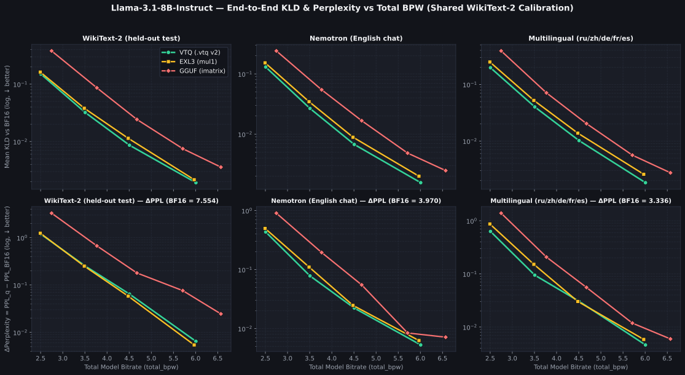
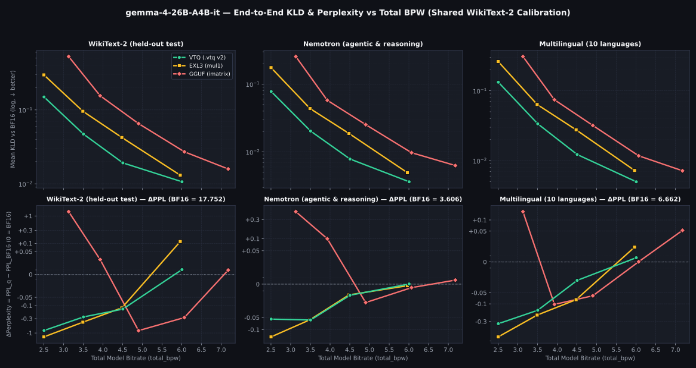
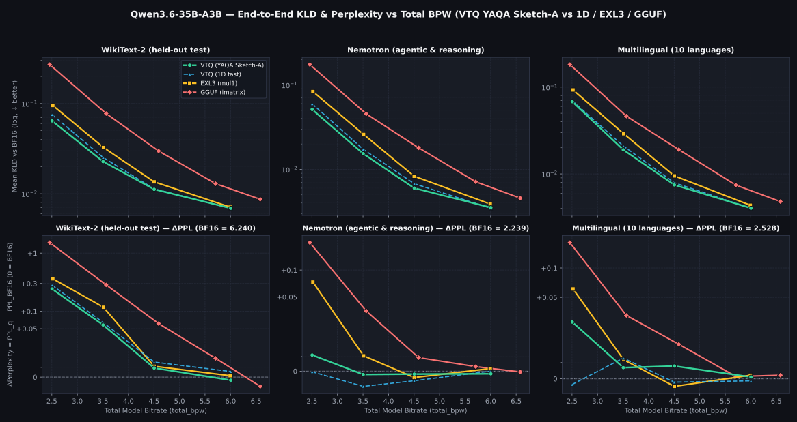
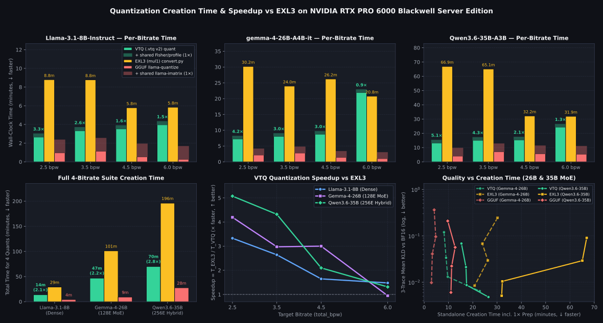

# End-to-End Format Comparison (`VTQ` vs `EXL3` vs `GGUF`)

All formats (`VTQ` `.vtq` v2, `EXL3` `mul1`, and `GGUF` `imatrix`) are quantized from the same BF16 checkpoint using a **shared domain-neutral stream calibration corpus** (`wikitext-2-raw-v1` `train`, `64 × 2048 = 131,072` tokens) and evaluated end-to-end (including quantized `embed_tokens` and `lm_head`) on three strictly disjoint held-out traces (`B = 2000` / `4000` paired bootstrap):
- **`wikitext2`** — held-out `wikitext-2-raw-v1` `test` split (`40` segments),
- **`nemotron`** — multi-turn agentic, SWE, math, and reasoning dialogues (`nem`),
- **`multilingual`** — `10`-language dialogues (`ru / de / es / fr / it / zh / ja / ko / pt / hi`, `mul`).

The default upstream VTQ solver (**`VTQ-SketchA`**, [`src/build_yaqa_sketch_a.py`](../../src/build_yaqa_sketch_a.py) + [`src/vtq_gptq2d.py`](../../src/vtq_gptq2d.py)) adds a reusable single-pass open multi-domain YAQA `Sketch-A` (`256 × 512`, strictly disjoint from all eval traces) step that produces 5-out `G_out` for two-sided GPTQ-2D and KL-weighted `H_in` (`0.50` blend with `H_stream`), with **zero changes to `.vtq` v2 bitstreams, `total_bpw`, or Velri decode kernels** (pass `--fast-1d` for the legacy 1D baseline `VTQ (1D)`).

Bitrates (`total_bpw`) are measured directly from the complete serialized text-model file size on disk (`total_text_bytes * 8 / total_text_params`). Across all **3 architectures × 4 target bitrates × 3 evaluation traces (`36 / 36` cells)**, **`VTQ-SketchA`** achieves strictly lower teacher-forced KLD than both `EXL3` (`35 / 36` statistically significant wins, `−27%..−34%` on `Llama-3.1-8B`, **`−52%..−57%` on `gemma-4-26B`** at `2.5–4.5 bpw`, `−21%..−35%` on `Qwen3.6-35B`) and `GGUF`, while also improving over 1D `VTQ` (**`22 / 36` statistically significant wins, `0 / 36` significant losses**) and remaining **1.4–2.3× faster** than `EXL3` across the full 4-bitrate suite (even including the one-time `Sketch-A` build). Standalone KLD-only plots (`*_kld.svg` / `.png`) are also in [`docs/figures/`](../figures/).

---

## `Llama-3.1-8B-Instruct` (Dense 8B GQA, `K_down = 14336`, `V = 128256`)

Raw JSON: [`results/paper_llama31_8b.json`](../../results/paper_llama31_8b.json) | Reference BF16 Perplexity (`nem` / `mul` / `wt2`): **`3.9697` / `3.3358` / `7.5537`**

| Method | `total_bpw` | `linear_bpw` | Quant Time | KLD (`nem` / `mul` / `wt2`) | $\Delta\text{PPL}$ (`nem` / `mul` / `wt2`) |
| :--- | :---: | :---: | :---: | :---: | :---: |
| **`VTQ-SketchA:2.5`** | **`2.5072`** | `2.4235` | `211.3 s`** | **`0.11202` / `0.14912`** / `0.15088` | **`+0.3660` / `+0.4677` / `+1.1490`** |
| `VTQ:2.5` *(1D fast)* | `2.5072` | `2.4235` | **`158.5 s`**\* | `0.13003` / `0.19752` / **`0.14959`** | `+0.4336` / `+0.6293` / `+1.1839` |
| `EXL3:2.5` | `2.4925` | `2.3353` | `527.5 s` | `0.15281` / `0.24938` / `0.16235` | `+0.4982` / `+0.8709` / `+1.2430` |
| `GGUF:IQ2_S` | `2.7481` | `2.4790` | `57.4 s`\* | `0.24075` / `0.39132` / `0.37948` | `+0.9033` / `+1.3874` / `+3.2839` |
| **`VTQ-SketchA:3.5`** | **`3.5072`** | `3.4188` | `260.7 s`** | **`0.02384` / `0.03126`** / `0.03318` | **`+0.0661` / `+0.0713` / `+0.2369`** |
| `VTQ:3.5` *(1D fast)* | `3.5072` | `3.4188` | **`199.3 s`**\* | `0.02670` / `0.04010` / **`0.03206`** | `+0.0781` / `+0.0947` / `+0.2515` |
| `EXL3:3.5` | `3.4862` | `3.3281` | `526.5 s` | `0.03460` / `0.05234` / `0.03804` | `+0.1105` / `+0.1513` / `+0.2503` |
| `GGUF:IQ3_M` | `3.7706` | `3.5754` | `67.8 s`\* | `0.05446` / `0.07111` / `0.08631` | `+0.1945` / `+0.2074` / `+0.6705` |
| **`VTQ-SketchA:4.5`** | **`4.5072`** | `4.4141` | `301.2 s`** | **`0.00601` / `0.00812` / `0.00830`** | **`+0.0099` / `+0.0166` / `+0.0461`** |
| `VTQ:4.5` *(1D fast)* | `4.5072` | `4.4141` | **`211.1 s`**\* | `0.00674` / `0.01018` / `0.00863` | `+0.0223` / `+0.0305` / `+0.0643` |
| `EXL3:4.5` | `4.4789` | `4.3197` | `347.3 s` | `0.00889` / `0.01380` / `0.01138` | `+0.0247` / `+0.0303` / `+0.0582` |
| `GGUF:Q4_K_S` | `4.6750` | `4.5361` | `31.5 s`\* | `0.01671` / `0.02033` / `0.02425` | `+0.0549` / `+0.0556` / `+0.1795` |
| `GGUF:Q5_K_M` | `5.7114` | `5.6532` | `29.6 s`\* | `0.00485` / `0.00563` / `0.00750` | `+0.0084` / `+0.0118` / `+0.0760` |
| **`VTQ-SketchA:6.0`** | **`6.0072`** | `5.9659` | `273.8 s`** | **`0.00141` / `0.00157` / `0.00181`** | **`+0.0017` / `+0.0037` / `+0.0041`** |
| `VTQ:6.0` *(1D fast)* | `6.0072` | `5.9659` | **`237.3 s`**\* | `0.00156` / `0.00184` / `0.00192` | `+0.0053` / `+0.0046` / `+0.0065` |
| `EXL3:6.0` | `5.9681` | `5.9579` | `350.6 s` | `0.00200` / `0.00259` / `0.00216` | `+0.0063` / `+0.0058` / `+0.0054` |
| `GGUF:Q6_K` | `6.5712` | `6.5625` | `15.7 s`\* | `0.00248` / `0.00275` / `0.00358` | `+0.0071` / `+0.0060` / `+0.0245` |

*\*Excluding shared `llama-imatrix` (`84.1 s`) and shared `VTQ` Fisher + slice profile (`22.3 s`). \*\*Excluding shared Fisher + profile (`22.3 s`) + `1×` YAQA Sketch-A (`185.7 s`).*

---

## `gemma-4-26B-A4B-it` (30-Layer 128-Expert MoE + Shared MLP, `I_moe = 704`, Tied `V = 262144`)

Raw JSON: [`results/paper_gemma4_26b.json`](../../results/paper_gemma4_26b.json) | Reference BF16 Perplexity (`nem` / `mul` / `wt2`): **`3.6057` / `6.6621` / `17.7525`**

| Method | `total_bpw` | `linear_bpw` | Quant Time | KLD (`nem` / `mul` / `wt2`) | $\Delta\text{PPL}$ (`nem` / `mul` / `wt2`) |
| :--- | :---: | :---: | :---: | :---: | :---: |
| **`VTQ-SketchA:2.5`** | **`2.5053`** | `2.4509` | `534.2 s`** | **`0.07196` / `0.12042`** / `0.15859` | `-0.0790` / `-0.3987` / `-0.9390` |
| `VTQ:2.5` *(1D fast)* | `2.5053` | `2.4509` | **`431.8 s`**\* | `0.07784` / `0.13225` / **`0.14941`** | **`-0.0547`** / `-0.3438` / **`-0.8128`** |
| `EXL3:2.5` | `2.5017` | `2.3577` | `1811.4 s` | `0.17516` / `0.26133` / `0.29695` | `-0.1520` / `-0.7823` / `-1.3879` |
| `GGUF:IQ2_S` | `3.1302` | `3.0401` | `128.4 s`\* | `0.25522` / `0.30800` / `0.52578` | `+0.4717` / **`+0.1677`** / `+1.4326` |
| **`VTQ-SketchA:3.5`** | **`3.5053`** | `3.4589` | `623.6 s`** | **`0.01757` / `0.03250`** / `0.04711` | **`-0.0320`** / `-0.1546` / `-0.3792` |
| `VTQ:3.5` *(1D fast)* | `3.5053` | `3.4589` | **`483.1 s`**\* | `0.02032` / `0.03361` / **`0.04703`** | `-0.0576` / `-0.1488` / `-0.2598` |
| `EXL3:3.5` | `3.4906` | `3.3166` | `1437.4 s` | `0.04366` / `0.06347` / `0.09573` | `-0.0567` / `-0.2009` / `-0.4033` |
| `GGUF:IQ3_M` | `3.9290` | `3.8312` | `166.4 s`\* | `0.05778` / `0.07418` / `0.15514` | `+0.0996` / **`-0.1034` / `+0.0326`** |
| **`VTQ-SketchA:4.5`** | **`4.5053`** | `4.4575` | `662.8 s`** | **`0.00719` / `0.01134`** / `0.01965` | **`-0.0120`** / `-0.0369` / `-0.1796` |
| `VTQ:4.5` *(1D fast)* | `4.5053` | `4.4575` | **`523.9 s`**\* | `0.00786` / `0.01223` / **`0.01918`** | `-0.0166` / **`-0.0299`** / `-0.1342` |
| `EXL3:4.5` | `4.4794` | `4.2753` | `1572.0 s` | `0.01874` / `0.02755` / `0.04231` | `-0.0161` / `-0.0770` / **`-0.1213`** |
| `GGUF:Q4_K_S` | `4.9030` | `4.8351` | `82.7 s`\* | `0.02530` / `0.03182` / `0.06521` | `-0.0276` / `-0.0603` / `-0.8204` |
| `GGUF:Q5_K_M` | `6.0660` | `6.0336` | `91.5 s`\* | `0.00975` / `0.01172` / `0.02710` | `-0.0052` / `+0.0003` / `-0.2728` |
| **`VTQ-SketchA:6.0`** | **`6.0053`** | `5.9883` | `1361.0 s`** | **`0.00361` / `0.00463` / `0.01020`** | `-0.0008` / **`-0.0037` / `-0.0095`** |
| `VTQ:6.0` *(1D fast)* | `6.0053` | `5.9883` | `1314.6 s`\* | `0.00363` / `0.00498` / `0.01066` | **`+0.0002`** / `+0.0069` / `+0.0107` |
| `EXL3:6.0` | `5.9618` | `5.7730` | **`1245.2 s`** | `0.00494` / `0.00724` / `0.01308` | `-0.0023` / `+0.0240` / `+0.1167` |
| `GGUF:Q6_K` | `7.1773` | `7.1791` | `60.3 s`\* | `0.00630` / `0.00716` / `0.01587` | `+0.0061` / `+0.0523` / **`+0.0095`** |

*\*Excluding shared `llama-imatrix` (`118.5 s`) and shared `VTQ` Fisher + slice profile (`57.4 s`). \*\*Excluding shared Fisher + profile (`57.4 s`) + `1×` YAQA Sketch-A (`541.0 s`).*

---

## `Qwen3.6-35B-A3B` (40-Layer 256-Expert MoE + Shared Expert + Gated DeltaNet Hybrid, `V = 248320`)

Raw JSON: [`results/paper_qwen36_35b.json`](../../results/paper_qwen36_35b.json) | Reference BF16 Perplexity (`nem` / `mul` / `wt2`): **`2.2367` / `2.5289` / `6.2448`**

| Method | `total_bpw` | `linear_bpw` | Quant Time | KLD (`nem` / `mul` / `wt2`) | $\Delta\text{PPL}$ (`nem` / `mul` / `wt2`) |
| :--- | :---: | :---: | :---: | :---: | :---: |
| **`VTQ-SketchA:2.5`** | **`2.5041`** | `2.4738` | `823.8 s`** | **`0.05121` / `0.06799` / `0.06416`** | `+0.0108` / `+0.0349` / **`+0.2413`** |
| `VTQ:2.5` *(1D fast)* | `2.5041` | `2.4738` | **`791.2 s`**\* | `0.05973` / `0.06958` / `0.07527` | **`-0.0004` / `-0.0035`** / `+0.2803` |
| `EXL3:2.5` | `2.5189` | `2.4777` | `4014.0 s` | `0.08347` / `0.09263` / `0.09507` | `+0.0734` / `+0.0610` / `+0.3612` |
| `GGUF:IQ2_S` | `2.4587` | `2.3758` | `240.5 s`\* | `0.17408` / `0.18170` / `0.27023` | `+0.2031` / `+0.1817` / `+1.5121` |
| **`VTQ-SketchA:3.5`** | **`3.5041`** | `3.4736` | `988.5 s`** | **`0.01533` / `0.01894` / `0.02269`** | **`-0.0022` / `+0.0068` / `+0.0579`** |
| `VTQ:3.5` *(1D fast)* | `3.5041` | `3.4736` | **`904.0 s`**\* | `0.01728` / `0.02097` / `0.02521` | `-0.0102` / `+0.0127` / `+0.0641` |
| `EXL3:3.5` | `3.5113` | `3.4706` | `3905.6 s` | `0.02594` / `0.02903` / `0.03253` | `+0.0103` / `+0.0117` / `+0.1168` |
| `GGUF:IQ3_M` | `3.5638` | `3.4991` | `423.7 s`\* | `0.04542` / `0.04630` / `0.07739` | `+0.0405` / `+0.0389` / `+0.2833` |
| **`VTQ-SketchA:4.5`** | **`4.5041`** | `4.4735` | `965.7 s`** | **`0.00600` / `0.00747` / `0.01118`** | **`-0.0020`** / `+0.0078` / **`+0.0094`** |
| `VTQ:4.5` *(1D fast)* | `4.5041` | `4.4735` | **`919.5 s`**\* | `0.00677` / `0.00791` / `0.01131` | `-0.0065` / **`-0.0021`** / `+0.0155` |
| `EXL3:4.5` | `4.5036` | `4.4634` | `1930.2 s` | `0.00829` / `0.00949` / `0.01354` | `-0.0043` / `-0.0047` / `+0.0112` |
| `GGUF:Q4_K_S` | `4.5908` | `4.5417` | `337.6 s`\* | `0.01798` / `0.01905` / `0.02973` | `+0.0091` / `+0.0212` / `+0.0613` |
| `GGUF:Q5_K_M` | `5.7077` | `5.6780` | `343.3 s`\* | `0.00713` / `0.00743` / `0.01291` | `+0.0031` / `+0.0014` / `+0.0194` |
| **`VTQ-SketchA:6.0`** | **`6.0041`** | `5.9850` | `1529.9 s`** | `0.00353` / `0.00403` / `0.00690` | `-0.0018` / **`+0.0011`** / `-0.0032` |
| `VTQ:6.0` *(1D fast)* | `6.0041` | `5.9850` | **`1459.7 s`**\* | **`0.00346` / `0.00402` / `0.00689`** | **`+0.0000`** / `-0.0013` / `+0.0058` |
| `EXL3:6.0` | `5.9918` | `5.9827` | `1914.2 s` | `0.00389` / `0.00436` / `0.00710` | `+0.0017` / `+0.0022` / **`+0.0015`** |
| `GGUF:Q6_K` | `6.5813` | `6.5626` | `320.1 s`\* | `0.00457` / `0.00480` / `0.00867` | `-0.0005` / `+0.0022` / `-0.0095` |

*\*Excluding shared `llama-imatrix` (`340.8 s`) and shared `VTQ` Fisher + slice profile (`128.1 s`). \*\*Excluding shared Fisher + profile (`128.1 s`) + `1×` YAQA Sketch-A (`769.4 s`).*

---

## Quantization Creation Time (`NVIDIA RTX PRO 6000 Blackwell Server Edition`)

All quantizations were executed on a single `NVIDIA RTX PRO 6000 Blackwell Server Edition` (`96 GB` VRAM). Both `VTQ` (`Fisher + slice profile` and `1×` YAQA `Sketch-A` Hessians) and `GGUF` (`llama-imatrix`) reuse shared calibration passes across all bitrates of a model, whereas `EXL3` (`exllamav3/convert.py`) captures layer Hessians inline during each conversion run.

| Model | Shared `1×` Prep (`Fisher + Sketch-A` / `GGUF`) | `2.5 bpw` (`Sketch-A` vs `EXL3`) | `3.5 bpw` (`Sketch-A` vs `EXL3`) | `4.5 bpw` (`Sketch-A` vs `EXL3`) | `6.0 bpw` (`Sketch-A` vs `EXL3`) | Full 4-Bitrate Suite incl. `1×` Prep (`Sketch-A` / `1D` vs `EXL3`) |
| :--- | :---: | :---: | :---: | :---: | :---: | :---: |
| **`Llama-3.1-8B-Instruct`** | `22.3 s + 185.7 s` / `84.1 s` | **`211.3 s`** vs `527.5 s` (**`2.5×`**) | **`260.7 s`** vs `526.5 s` (**`2.0×`**) | **`301.2 s`** vs `347.3 s` (**`1.2×`**) | **`273.8 s`** vs `350.6 s` (**`1.3×`**) | **`20.9 min` (`1.4×`)** / `13.8 min` (`2.1×`) vs `29.2 min` |
| **`gemma-4-26B-A4B-it`** | `57.4 s + 541.0 s` / `118.5 s` | **`534.2 s`** vs `1811.4 s` (**`3.4×`**) | **`623.6 s`** vs `1437.4 s` (**`2.3×`**) | **`662.8 s`** vs `1572.0 s` (**`2.4×`**) | `1361.0 s` vs **`1245.2 s`** (`0.9×`) | **`63.0 min` (`1.6×`)** / `46.8 min` (`2.2×`) vs `101.1 min` |
| **`Qwen3.6-35B-A3B`** | `128.1 s + 769.4 s` / `340.8 s` | **`823.8 s`** vs `4014.0 s` (**`4.9×`**) | **`988.5 s`** vs `3905.6 s` (**`4.0×`**) | **`965.7 s`** vs `1930.2 s` (**`2.0×`**) | **`1529.9 s`** vs `1914.2 s` (**`1.3×`**) | **`86.8 min` (`2.3×`)** / `70.0 min` (`2.8×`) vs `196.1 min` |

---

## Reproducing All Benchmarks & Figures

All SVG/PNG figures in `docs/figures/` can be regenerated directly on `main` from `results/paper_*.json` via `python -m src.plot_paper_benchmarks`. For full end-to-end re-execution from BF16 checkpoints — including the tracked held-out evaluation traces (`data/`), `SHA-256` manifest, and step-by-step `llama.cpp` / `exllamav3` build instructions — switch to the [`paper-repro`](https://github.com/velri-inference/vtq-research/tree/paper-repro) branch (`git checkout paper-repro`). Pass `--fast-1d` to `src/run_paper_benchmarks.py` to opt out of YAQA `Sketch-A` and reproduce the fast 1D VTQ baseline.
